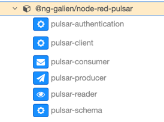
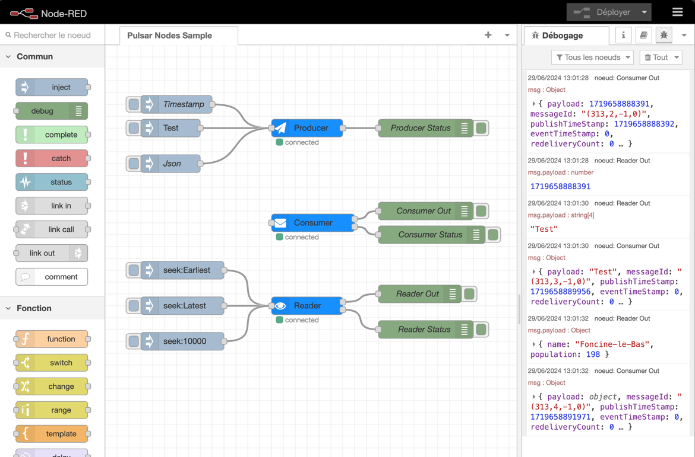

[](https://github.com/ng-galien/node-red-pulsar/actions/workflows/build.yml)

# node-red-pulsar

[](https://github.com/ng-galien/node-red-contrib-pulsar/actions/workflows/build.yml)
[](https://www.npmjs.com/package/@ng-galien/node-red-pulsar)
[](LICENSE)
[](https://nodejs.org/)

Add Apache Pulsar support to Node-RED.

This package provides nodes to send and receive messages from Apache Pulsar in your Node-RED flows.



## Table of Contents

- [Features](#features)
- [Requirements](#requirements)
- [Installation](#installation)
- [Quick Start](#quick-start)
- [Nodes](#nodes)
  - [Pulsar Client](#pulsar-client)
  - [Pulsar Authentication](#pulsar-authentication)
  - [Pulsar Schema](#pulsar-schema)
  - [Pulsar Producer](#pulsar-producer)
  - [Pulsar Consumer](#pulsar-consumer)
  - [Pulsar Reader](#pulsar-reader)
- [Example Flow](#example-flow)
- [Development](#development)
- [Contributing](#contributing)
- [License](#license)

## Features

- **Producer**: Send messages to Pulsar topics with configurable routing, batching, and compression
- **Consumer**: Subscribe to topics with shared, exclusive, or failover subscription modes
- **Reader**: Read messages from topics with seek support (earliest, latest, or timestamp)
- **Schema Support**: Avro and JSON schema validation
- **Authentication**: Token, OAuth2, and TLS certificate authentication
- **TLS**: Secure connections with certificate validation

Based on the [Pulsar Node.js client](https://github.com/apache/pulsar-client-node).

## Requirements

- Node.js >= 18.0.0
- Node-RED >= 3.0.0
- Apache Pulsar cluster (standalone or distributed)

## Installation

Run the following command in your Node-RED user directory (typically `~/.node-red`):

```bash
npm install @ng-galien/node-red-pulsar
```

Or install via the Node-RED Palette Manager by searching for `@ng-galien/node-red-pulsar`.

## Quick Start

1. **Start a Pulsar instance** (for testing):

```bash
docker run -it -p 6650:6650 -p 8080:8080 apachepulsar/pulsar:3.0.2 bin/pulsar standalone
```

2. **Configure the Pulsar Client node** with `pulsar://localhost:6650`

3. **Add a Producer node** to send messages to a topic

4. **Add a Consumer node** to receive messages from the topic

## Nodes

### Pulsar Client

Configuration node for Pulsar connection settings.

| Property | Description |
|----------|-------------|
| Service URL | Pulsar broker URL (e.g., `pulsar://localhost:6650`) |
| Authentication | Optional authentication configuration |
| Use TLS | Enable TLS encryption |
| Operation Timeout | Timeout for operations in seconds |

### Pulsar Authentication

Configuration node for authentication methods.

| Method | Description |
|--------|-------------|
| Token | JWT token authentication |
| OAuth2 | OAuth 2.0 client credentials flow |
| TLS | Client certificate authentication |

### Pulsar Schema

Configuration node for message schemas.

| Type | Description |
|------|-------------|
| JSON | JSON schema validation |
| Avro | Avro schema validation |

### Pulsar Producer

Send messages to a Pulsar topic.

**Input**: `msg.payload` - Message content to send

**Output**: Status messages (sent, error)

| Property | Description |
|----------|-------------|
| Topic | Target topic name |
| Compression | Compression type (None, LZ4, ZLIB, ZSTD, SNAPPY) |
| Batching | Enable message batching |

### Pulsar Consumer

Receive messages from a Pulsar topic subscription.

**Output 1**: Received messages (`msg.payload`)

**Output 2**: Status messages

| Property | Description |
|----------|-------------|
| Topic | Topic to subscribe |
| Subscription | Subscription name |
| Subscription Type | Shared, Exclusive, Failover, or Key_Shared |

### Pulsar Reader

Read messages from a topic with seek capability.

**Input**: Seek commands (`msg.topic = "seek"`, `msg.payload = "Earliest" | "Latest" | timestamp`)

**Output 1**: Read messages

**Output 2**: Status messages

| Property | Description |
|----------|-------------|
| Topic | Topic to read |
| Start Position | Initial position (Earliest, Latest) |

## Example Flow

A sample flow is provided in [`examples/pulsar-nodes.json`](examples/pulsar-nodes.json). Import it into Node-RED to get started.



The example demonstrates:

- Sending string and JSON messages with a Producer
- Receiving messages with a Consumer using JSON schema
- Reading messages with a Reader and seek operations

## Development

### Setup

```bash
git clone https://github.com/ng-galien/node-red-contrib-pulsar.git
cd node-red-contrib-pulsar
npm install
```

### Commands

```bash
npm run build       # Compile TypeScript
npm run lint        # Run ESLint
npm test            # Run tests
npm run clean       # Remove build artifacts
```

### Testing with Docker

See [CLAUDE.md](CLAUDE.md) for detailed E2E testing instructions with Docker.

## Contributing

Contributions are welcome! Please read our [Contributing Guide](CONTRIBUTING.md) for details on:

- Code of Conduct
- Development setup
- Submitting pull requests
- Reporting issues

## License

[ISC](LICENSE) - Copyright (c) Alexandre Boyer
